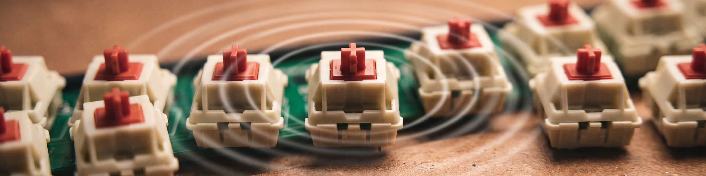

# KeyEcho

<p align="center"></p>

> Listen to your keyboard typing and echo pleasant sounds

- ⚡️ Minimal CPU and memory usage, instant keystroke response
- 📦 Less than 5 MB in size, cross-platform compatibility
- 🛠️ Customizable sounds to suit your preferences

[More about its performance comparison and under the hood.](https://webdeveloper.beehiiv.com/p/opensourced-keyecho-fastresponsive-keyboard-sounds-every-keystroke-using-tauri)

## 🚀 Install

Supports Windows (64-bit/ARM64), macOS (Intel/Apple M1/M2), and Linux (64-bit/ARM64/ARMv7).

Visit the [release page](https://github.com/ZacharyL2/KeyEcho/releases) to download the appropriate installation package.

## 🎵 Custom Sounds

Want to create your own keyboard sounds? Check out our [Custom Sounds Guide](CustomSounds.md) for detailed instructions on recording, processing, and adding your own sound packs to KeyEcho.

## 🧑‍💻 Development

### Prerequisites

#### Installing Rust and Cargo

Cargo is the package manager for Rust. If you don't have it installed, follow these steps:

1. Visit the [Rust installation page](https://www.rust-lang.org/tools/install).
2. Follow the instructions for your operating system to install Rust and Cargo.
3. Verify the installation by running `cargo --version` in your terminal.

#### Installing pnpm

pnpm is a fast, disk space-efficient package manager for JavaScript. To install:

1. Visit the [pnpm installation page](https://pnpm.io/installation).
2. Choose the installation method that suits your operating system.
3. Verify the installation by running `pnpm --version` in your terminal.

### Building and Running the Project

```bash
# Clone the repository
$ git clone git@github.com:ZacharyL2/KeyEcho.git
$ cd KeyEcho

# Install dependencies
$ pnpm install

# Development
$ pnpm dev

# Build
$ pnpm build

# To run the Rust backend separately:
$ cd src-tauri
$ cargo run

# Then, from the root of the project, start the frontend:
$ pnpm web:dev
```
